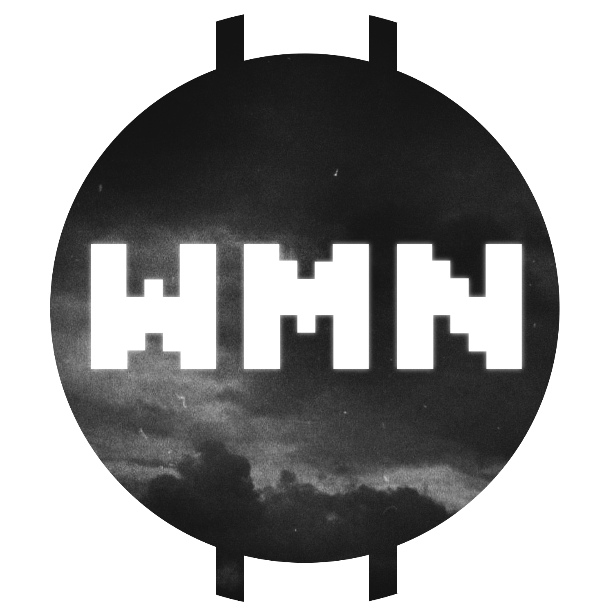
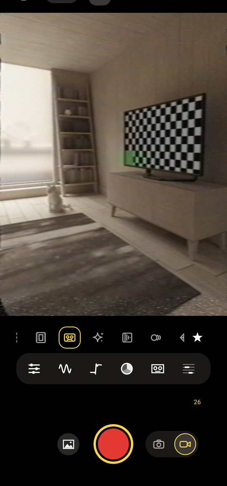
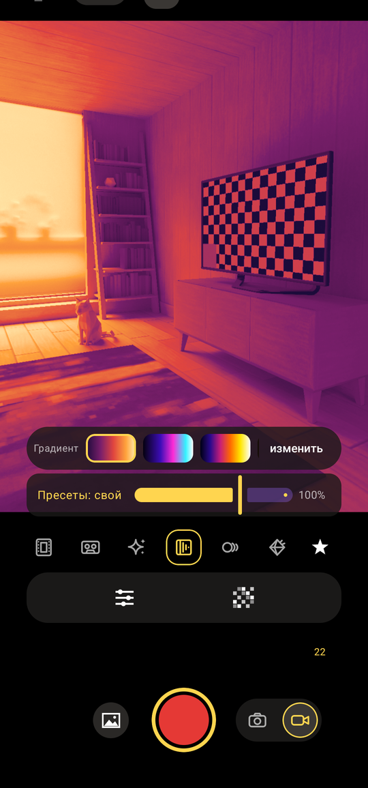
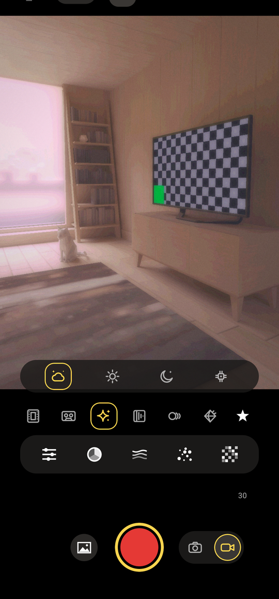
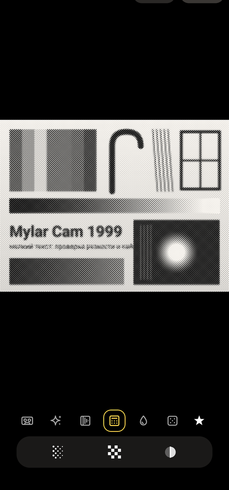
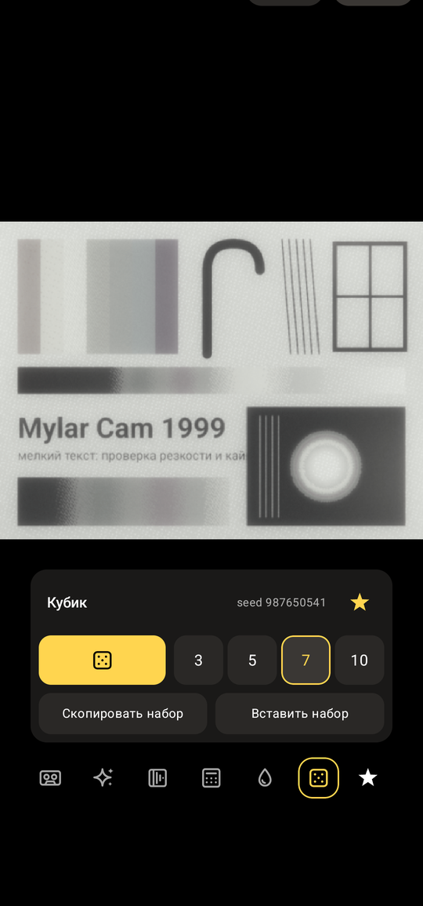

# Mylar Cam



Автор: wmn — Telegram: https://t.me/wmncustoms

Разработано вайбкодингом: код написан Claude Code (Anthropic) по задачам и идеям автора.

Android-камера с ретро-эффектами в реальном времени: пиксели, плёнка, VHS с экраном кинескопа, «ядра» в духе
интернет-эстетик, карта градиента, следы движения — и редактор фото и видео из галереи со слоями.
Kotlin, Jetpack Compose, CameraX, OpenGL ES 3.

*English summary below.*

| Камера: VHS | Камера: Градиент | Камера: Cores | Редактор: Газета | Редактор: Кубик |
|---|---|---|---|---|
|  |  |  |  |  |

## Что умеет

**Режимы камеры** (эффект вшивается в фото и видео, превью = результат):

- **Пиксель** — крупные пиксели, приглушённый цвет, выцветшие чёрные.
- **Плёнка** — характер плёночного фото: цвет, тон, раздельная тонировка, halation, зерно, смаз.
- **VHS** — домашнее видео 90-х: размытый и сдвинутый цвет, строки, шум ленты, дрожание, головки, трекинг; плюс
  экран кинескопа — маска люминофора, кривизна, цветные облака, волна.
- **Cores** — четыре стиля: Dream, Sun, Dark, Circuit.
- **Градиент** — карта градиента по яркости, редактор градиентов (до 30 точек), обмен кодом.
- **Гостинг** — следы движения (застывшие копии или эхо), форма шлейфа от чёткой до «убитого JPEG».

**Редактор** фото и видео из галереи: слои (у каждого свой режим, пресет, непрозрачность), плеер видео с цепочкой
слоёв в реальном времени, офлайн-сохранение видео, кнопка «К исходному» с отменой. Только в редакторе: **Газета**
(полутоновая печать: ЧБ-растр, розетка CMYK, RGB-каналы, цвет бумаги), **Выбор цвета** (пипетка с лупой, кривая для
ЧБ-части), **Кубик** (случайная цепочка из 3–10 слоёв с seed; результат можно сохранить как набор и поделиться кодом).

Общее: пресеты с силой, миниатюрами и предпросмотром долгим нажатием, обмен кодами `MYLAR1:`, штамп даты, сетка,
уровень, таймер, справка с живыми примерами на тестовой картинке. Размеры эффектов заданы в долях кадра, анимация —
по времени, поэтому превью, фото и видео любого разрешения выглядят одинаково.

## Сборка

Нужны JDK 17+ (подходит встроенный в Android Studio) и Android SDK с платформой **API 37** (`compileSdk = 37`,
`minSdk = 26` — Android 8.0+). Gradle 9.8.2 скачивается обёрткой.

```bash
./gradlew assembleRelease
```

На Windows — `.\gradlew assembleRelease`, при необходимости
`$env:JAVA_HOME = "C:\Program Files\Android\Android Studio\jbr"`. Готовый APK копируется в
`output/Mylar-Cam-<версия>.apk`. Версия задаётся только в `version.properties`. Можно открыть проект в Android Studio
и собрать оттуда.

### Подпись

Без настроек release подписывается debug-ключом вашего Android SDK. Чтобы подписывать своим ключом, создайте его
**вне репозитория** и файл `keystore.properties` в корне проекта (он в `.gitignore`):

```bash
keytool -genkeypair -v -keystore ~/keys/mylar-cam.jks -alias mylar -keyalg RSA -keysize 4096 -validity 10000
```

```properties
storeFile=/home/you/keys/mylar-cam.jks
storePassword=...
keyAlias=mylar
keyPassword=...
```

Храните ключ и пароли в резервной копии: обновление приложения ставится поверх только с тем же ключом, при смене
ключа приложение придётся удалить и установить заново (настройки и свои пресеты пропадут).

## Установка

Скачайте `Mylar-Cam-<версия>.apk` из раздела **Releases**, откройте на телефоне и разрешите установку из этого
источника. Или по кабелю: `adb install -r Mylar-Cam-<версия>.apk`.

## Ограничения

Это личный эксперимент, а не продукт: проверялся на эмуляторе и нескольких конкретных телефонах. Возможности камер
определяются в рантайме, но на других устройствах возможны проблемы с частотой кадров, кодеками и тяжёлыми режимами.
Звук записывается без обработки. Подробности устройства и история версий — [docs/DEVELOPMENT.md](docs/DEVELOPMENT.md).

## Благодарности

Автор: **wmn** (waitmenear), Telegram-канал: https://t.me/wmncustoms

- [ntsc-rs](https://github.com/ntsc-rs/ntsc-rs) — описание стадий аналогового сигнала, по которому написан режим VHS.
- AndroidX CameraX, Media3, Jetpack Compose и примеры Android.
- Список сторонних компонентов и лицензий — [THIRD_PARTY.md](THIRD_PARTY.md).

## Лицензия

MIT, Copyright (c) 2026 wmn (waitmenear) — см. [LICENSE](LICENSE).

---

## English

**Mylar Cam** is an Android camera with real-time retro effects: Pixel, Film, VHS (with a CRT screen: phosphor mask,
curvature, colour clouds), Cores (Dream, Sun, Dark, Circuit), Gradient map and Ghosting (motion trails).
Effects are baked into photos and video. A gallery editor applies layered effects to photos and videos (real-time
playback, offline video export, one-tap back to original with undo) and adds Newspaper halftone, Color select (loupe
picker) and Dice — a random layer chain with a reproducible seed that can be saved as a named set or shared as a
`MYLAR1:` code. Author: wmn — Telegram: https://t.me/wmncustoms

Built by vibe coding: the code was written by Claude Code (Anthropic) from the author's ideas and tasks.

Build: JDK 17+, Android SDK platform 37, `./gradlew assembleRelease` (the APK lands in `output/`). Install the APK from
GitHub Releases.
This is a personal experiment tested on a few devices only. Third-party notices: [THIRD_PARTY.md](THIRD_PARTY.md).
